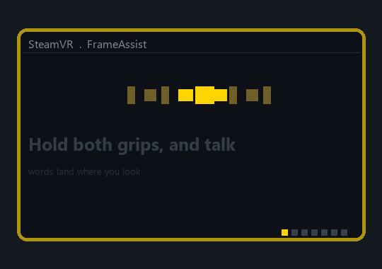
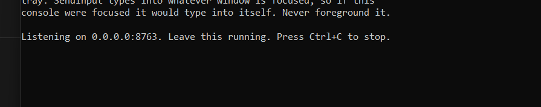
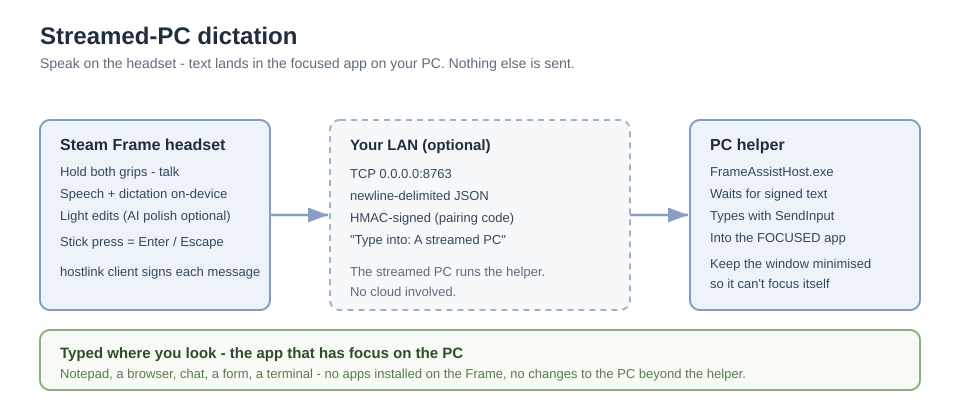

# FrameAssist

**Voice typing for the Steam Frame.** Hold both grips, talk, let go — your
words land in whatever text box is focused on the Frame: Steam chat, the
browser, the terminal, desktop apps.

No on-screen keyboard, no Bluetooth keyboard, no cloud. Speech recognition
runs on the headset itself, with no account and nothing sent online. (There's
an optional AI polish that sends only the *text* of a dictation through your
own OpenRouter account.)

Inspired by — and built on the proven Steam Frame architecture of —
[frame-voice](https://github.com/juanramosjr1/frame-voice) (MIT): an independent,
open-source implementation of voice typing for the Steam Frame.

### Why this exists

Because nobody shipped a true **PC-streaming** dictation assistant. The Frame
apps that exist target the headset itself — but that doesn't solve the actual
use case: replying on social media, doing quick work, or jumping into a chat
**while you're in a streamed PC game**, without installing anything directly on
the Frame. FrameAssist covers that gap: you wear the headset, speak, and the
text is typed into the real PC in front of you.

---

## In action



The headset types into whatever window has focus on the streamed PC — here is
the PC helper alongside a plain editor:



(The pairing code and LAN address are shown on your own screen only.)

How it fits together:



---

## How you use it

| What you want | How (default buttons) |
| --- | --- |
| Type with your voice | Hold **both grips**, talk, let go |
| Hands-free dictation | **Double-tap both grips**, put the controllers down and talk (up to 10 minutes); tap both grips once to stop |
| Copy your last dictation | **Double-tap the left grip** |
| Paste | **Double-tap the right grip** |
| Send (Enter) | **Quickly press (click) the right stick** |
| Escape / back | **Quickly press (click) the left stick** |

Every dictation is also copied to the clipboard, so you can paste it again
anywhere. In games, FrameAssist's buttons rest and the game keeps them — turn
on **Keep shortcuts on during VR games** in Settings to override.

FrameAssist treats the Frame's own desktop and a streamed PC (`vrlink`) as
*home*, not a game — buttons stay live there, so dictating into a streamed PC
always works. The "rest in games" behavior applies to a real game scene
launched with its own SteamVR app key.

A single **"Listening…" / "Typing…"** badge floats below your view while you
talk, so you don't need the window open.

## Known limits

- **Typing reaches the Frame's own focused window** — Steam chat, the browser,
  the terminal, desktop apps on the Frame. That's the supported, tested use.
- **Typing into a PC streamed into VR is supported (opt-in).** A streamed
  desktop is only *video* to the Frame, so keystrokes injected on the Frame
  can't reach it — that part is a real platform limit (see
  [docs/FRAME_DEBUG_NOTES.md](docs/FRAME_DEBUG_NOTES.md), "Wall 2"). FrameAssist
  gets around it by sending the **finished text** to a small helper **running on
  the PC**, which types it there with native Windows `SendInput`. Turn it on with
  **Settings → Type into → A streamed PC** — see
  [Type into a streamed PC](#type-into-a-streamed-pc). The default, always-available
  path is still typing into the Frame's own focused window.
- US keyboard layout; accented characters are normalized to ASCII equivalents.
- Speech transcription runs on the headset's CPU/GPU; a heavy VR game may
  stutter briefly while a clip transcribes.

## Type into a streamed PC

By default FrameAssist types into the **Frame's own** focused window. If you
stream a Windows PC's desktop into VR (Steam Remote Play / vrlink) and want
your words to land in an app *on that PC*, switch FrameAssist to the opt-in
**streamed-PC** mode.

A streamed desktop is just video to the Frame, so there is nothing to type into
there. In this mode FrameAssist sends the **finished text** over your local
network to a small helper running on the PC, which types it with the native
Windows `SendInput` API — functionally identical to a physical keyboard plugged
into the PC. Speech still runs entirely on the headset; only the final text
crosses your LAN, and it's authenticated with a pairing code.

### Windows side — run the helper

`FrameAssistHost.exe` is a **separate download** from the
[Releases page](https://github.com/Oliver-S3/frameassist/releases/latest) — it
is *not* part of the Frame install (see
[Optional install](#optional-install-what-is-and-is-not-optional)). No build
needed: pick a release artifact and run it.

Two builds are published from the same code — pick one:
- **`FrameAssistHost.exe`** (single file) — download-and-run in one file; a
  plain double-click works on normal Windows PCs.
- **`FrameAssistHost-<version>-win64.zip`** — **recommended**: extract the
  folder and run `FrameAssistHost\FrameAssistHost.exe`. It runs in place with
  no self-extraction, so it also works where an antivirus or a locked-down
  session blocks one-file apps (and starts faster).

> **Signed builds.** Both builds are code-signed (CN=FrameAssistHost, SHA-256 +
> SHA-1, timestamped). On a fresh PC, SmartScreen may ask **once** —
> **"More info → Run anyway"** — because the publisher is self-signed; that is
> expected and safe (a one-time approval per download). Your own machines can
> skip the prompt entirely with `host/signing/trust-FrameAssistHost.ps1`.

1. Download either artifact and run it on the PC. No Python or install step is
   needed.
2. The first time it runs, Windows Firewall asks for permission. Tick
   **"Allow access on Private networks"** (leave **Public** unchecked) and click
   **Allow access** — it opens a port on your LAN so the Frame can reach it.
3. The console prints the values you'll enter on the headset:

   ```
   PC address : 192.168.x.y:8763
   Pairing code : K7QF-3MZX   (example — your code is shown by the helper)
   ```

   Leave the helper running, **minimised** (see the caveats below).
   > **If text isn't appearing even with the target app focused:** some managed
   > or antivirus-policy setups block simulated typing. If so, run
   > `FrameAssistHost.exe` **as Administrator** (right-click → Run as
   > administrator) — that resolves it. Most normal PCs don't need this.

### Headset side — point FrameAssist at the PC

Open **Settings** → **Type into** → **"A streamed PC (over your network)"**, then
fill in the three fields the helper printed:

| Field | Example |
| --- | --- |
| PC address | `192.168.x.y` |
| PC port | `8763` (default) |
| Pairing code | `K7QF-3MZX` (the one the helper printed) |

Tap **Test connection** — it reports **reachable** when the PC helper answers.
Then **Save**. Dictation now goes to the PC.

### What each gesture does in streamed-PC mode

| Gesture | On the PC |
| --- | --- |
| Hold both grips, talk | Types the dictation into the PC's focused window (and Enter after, if "Press Enter" is on) |
| Quickly press (click) the right stick | Enter |
| Quickly press (click) the left stick | Escape |
| Double-tap the right grip | Paste (Ctrl+V) |
| Double-tap the left grip | Copy onto the **PC's** clipboard |

### Two caveats that matter (correctness, not polish)

- **Keep the helper window minimised or in the tray.** `SendInput` types into
  whatever window is focused *on the PC*; if the helper's own console is focused,
  it would type into itself. Minimise it once you've read the address and pairing
  code.
- **If the Steam client has focus, click the target app once on the PC first.**
  Keys go to the PC's *existing* foreground window — the helper never steals focus
  (it never calls `SetForegroundWindow`), so make sure the app you want (Notepad,
  a browser, a game's chat box) is the focused one before you talk.

### Manual end-to-end checklist

The first time you set this up, walk through these:

1. Run `FrameAssistHost.exe` on the PC; at the firewall prompt tick **Allow access
   on Private networks**; note the printed **PC address** and **pairing code**.
2. On the headset, **Settings → Type into → A streamed PC**, enter the address,
   port and code, then tap **Test connection** → **reachable**.
3. On the PC, open **Notepad**, click into it so it's focused, and stream the
   desktop into VR.
4. Hold both grips and dictate — include **accents and emoji** (e.g. `café`,
   `🎉`). It appears in Notepad **verbatim**.
5. Quickly press (click) the **right** stick = Enter, the **left** = Escape,
   double-tap **right grip** =
   paste, double-tap **left grip** = copy (then Ctrl+V on the PC to confirm the
   **host** clipboard was set).
6. Close the helper, then dictate again: the badge shows **"Can't reach the PC
   helper…"** and your text is still on the **Frame's** clipboard, so nothing is
   lost.
7. Bring the helper's own window to the front and dictate: it **never types into
   itself** (it stays minimised in normal use).

### Optional install: what is and is not optional

"Optional" means two different things here, so to be explicit:

- **Headset side (the Frame):** streamed-PC is a **Settings toggle** that
  defaults to **"This headset"** (`frame`). The local uinput typing path is
  unchanged and is what you get unless you switch it on.
- **Windows side (the PC):** we still **build and ship** `FrameAssistHost.exe` —
  it's a **separately downloadable release artifact** linked from this README. It
  is **not bundled into `install.sh`**, so the default Linux install on the Frame
  is completely unchanged. You simply choose to download and run it when you want
  to type into a streamed PC.

### Future work

v1 uses **manual IP entry** — you type the PC's address yourself. Automatic
discovery of the PC on your LAN (**UDP auto-discovery**) is planned future work.

## Install (about 5 minutes, once)

1. **Open the desktop on your Frame** (switch to Linux desktop / KDE) and open **Konsole**.
2. **Copy and paste one of these lines, then press Enter:**
   - **One-line install** (once the project is published on GitHub — the URL
     below is a placeholder):
     ```bash
     curl -fsSL https://raw.githubusercontent.com/Oliver-S3/frameassist/main/install.sh | bash && exec bash
     ```
   - **From a source checkout** (e.g. while the project still lives on your own
     Git server — clone it onto the Frame first):
     ```bash
     git clone https://github.com/Oliver-S3/frameassist && cd frameassist && ./install.sh
     ```
   The installer shows 5 steps and tells you when it's done. Running it again
   updates the app.
   > If it asks for a password: voice typing needs permission to act like a
   > keyboard. No password yet? Press `Ctrl+C`, type `passwd`, set a password,
   > then run the line again.
3. *(Optional, recommended)* **Enable the Check for updates button.** Install with
   your repo URL set so the app knows where to look for new versions, then it
   checks `<base>/raw/<branch>/version.json` and updates itself from the repo:
   ```bash
   FRAMEASSIST_UPDATE_BASE=https://github.com/Oliver-S3/frameassist ./install.sh
   ```
   (For example: `FRAMEASSIST_UPDATE_BASE=https://github.com/Oliver-S3/frameassist ./install.sh`
   — see [Updates and the update button](#updates) for Gitea vs GitHub URL forms.)
   Without it, Settings → Check for updates simply says no update source is
   configured. See [Updates](#updates).

4. **Open FrameAssist** from your apps. If the window says the shortcuts need a
   SteamVR setting, tap **Turn on** (that's SteamVR's *Enable global input
   from overlays*).

That's it. From now on FrameAssist starts in the background every time SteamVR
starts, so the shortcuts work whenever the headset is on.

To make sure everything is set up, run:
```bash
~/.local/bin/frameassist --check
```

## Updates

**Settings → Check for updates** checks your install's repo for a newer version
and updates the app in place (with automatic rollback if an update fails).

- It works when FrameAssist was installed with `FRAMEASSIST_UPDATE_BASE` set (see
  [Install](#install-about-5-minutes-once)); the app then reads
  `<base>/raw/<branch>/version.json` and installs the matching source archive
  (`<base>/archive/<branch>.tar.gz`).
- Each release bumps `__version__` (`pyproject.toml`, `frameassist/__init__.py`)
  and `version.json` together — the button only updates when the repo reports a
  **higher** version, so keep them in lockstep.
- `~/.local/bin/frameassist --check` shows whether an update source is configured
  (it prints the URL under "In-app updates").
- Moving between hosts (e.g. a private Git server now, GitHub later) is a
  one-line change: install with the new `FRAMEASSIST_UPDATE_BASE` and re-run the
  installer. The check/archive URL pattern (`raw/<branch>/version.json` +
  `archive/<branch>.tar.gz`) is the same on Gitea and GitHub.

## Getting help / diagnostics

If something doesn't work, run `~/.local/bin/frameassist --check` and share the
output. There's also a real-device test checklist in
[docs/DEVICE_TEST_CHECKLIST.md](docs/DEVICE_TEST_CHECKLIST.md). `--host-test`
pings your configured PC helper without needing a microphone, to isolate a
streamed-PC problem to the network/helper.

| Problem | Fix |
| --- | --- |
| Nothing gets typed | Click the text box first, then hold both grips. If it still doesn't work, run `frameassist --check`. If "Can type into apps" says FIX, run the installer again and restart. |
| Controller shortcuts do nothing | In Settings use **Test your buttons**. If it says a SteamVR setting is needed, tap **Turn on** (or SteamVR → Developer → *Enable global input from overlays*), then restart the headset. |
| Shortcuts stop during a game | That's on purpose. Open the Steam menu, or turn on **Keep shortcuts on during VR games**. |
| Voice triggers in a streamed PC game | Turn on **Rest shortcuts while a PC is streamed in** in Settings — shortcuts rest during streamed-PC sessions (so the streamed game keeps its buttons), while the Steam dashboard exception keeps them live on the streamed desktop, so you can still dictate there. |
| "Didn't catch that" | Speak a little closer/longer, or pick **Most accurate** in Settings. |
| Words come out wrong | Pick **Most accurate**, talk close to the mic. For names, add them to **My words**. |
| Wrong characters | FrameAssist types as a US keyboard layout. |
| "Test connection" fails for a streamed PC | Is the helper still running (window open, showing `Listening on 0.0.0.0:8763`)? Is the headset on the same Wi-Fi/LAN (same `192.168.x` subnet)? Use the helper's **LAN** address (not a VPN/Tailscale one) and the exact **pairing code printed this run**. If the firewall prompt's "Allow on Private networks" alone isn't enough (common when the PC has a Public-classified link or the helper exe path changed between builds), open an **Administrator PowerShell on the PC** and allow the port on all profiles: `netsh advfirewall firewall add rule name="FrameAssistHost TCP 8763" dir=in action=allow protocol=TCP localport=8763 enable=yes profile=any` |
| Types land in the wrong window on the PC | The helper sends keys to whatever has focus *on the PC*. Click the target app once on the PC (if the Steam client has focus), and keep the helper minimised so it never types into itself. |
| Pairing code keeps changing | The helper stores its code in `%APPDATA%\FrameAssistHost\config.json` so it stays the same across restarts. If the console prints a *new* code each launch, its config folder isn't writable on that machine. |

## Settings

- **Speech model**: Fast / Balanced / Most accurate (tiny / base / small
  Whisper model, picked once and used every time).
- **Text**: add a space after each dictation; press Enter after each dictation;
  type into the text box or only copy to the clipboard.
- **Buttons**: keep shortcuts on during VR games; start automatically with
  SteamVR.
- **AI polish**: tidy each dictation with an AI model — **your OpenRouter
  account** (default; only the text is sent) **or a local OpenAI-compatible
  server** by setting **AI base URL** to e.g. `http://localhost:11434/v1`
  (Ollama) or `http://localhost:1234/v1` (LM Studio). An **API key is
  required** either way — for OpenRouter, your OpenRouter key; for a local
  server, that server's key if it enforces one (many do). **AI model**
  optionally overrides the default model. Off by default.

## Calibrate

The Frame's IPD wheel shows a number, but lens spacers and face fit shift the
real optical alignment, so what you *see* matters more than the dial. **Calibrate**
(button in the window) shows on-headset charts ~1.4 m away while you roll the
wheel and talk:

- **Resolution** — a Siemens star and fine line pairs; roll the wheel until the
  centre is crisp and free of doubling.
- **Alignment** — a crosshair with two vertical bars and rings; with the right
  IPD the bars look centred and single.
- **Sweet spot** — fine centre detail plus corner markers to find your best lens
  position.

Navigation reuses your gestures: **quickly press (click) the right stick =
next**, **the left stick = back**, and talking to the chart works too — "finer", "coarser", "next", and
"save as with-spacers" to remember a profile per fitment. Profiles live in
`~/.config/frameassist/profiles.json`.

## My words

Names and words the speech model keeps getting wrong (like a game's name).
Tap **Edit my words**, put one on each line, and save. Your next dictation
spells them your way. The list is `~/.config/frameassist/words.txt` if you'd
rather edit it yourself — keep it short, only words it gets wrong.

## Uninstall

```bash
bash ~/.local/share/frameassist/uninstall.sh
```

This removes the app and stops it starting with SteamVR, but **keeps** your
settings and My Words (in `~/.config/frameassist`). Add `--purge` to remove
those and the logs too.

```bash
bash ~/.local/share/frameassist/uninstall.sh --purge
```

## How it works (for the curious)

- **Speech to text:** [faster-whisper](https://github.com/SYSTRAN/faster-whisper),
  running locally on the headset's ARM CPU.
- **Typing:** a virtual USB keyboard through Linux `uinput`, so anything that
  accepts a real keyboard accepts it, including the Steam client. Pure Python,
  nothing to compile.
- **Controller shortcuts:** SteamVR Input, with each button (left grip, right
  grip, left stick, right stick) in its own action set, so the app only takes
  what it needs and games keep their buttons. Gestures (hold, double-tap,
  flick — a quick press-and-release of a stick) are worked out by the app, not
  by SteamVR. Default bindings for the
  Steam Frame controllers (`frame_controller`), plus Quest/Touch and Index.
  The app uses Valve's official Linux ARM64 OpenVR library.
- **Starting with SteamVR:** a user service that starts and stops with
  `steamvr.service` (the way SteamOS runs SteamVR), and runs the shortcuts
  without a window. Opening the app hands the shortcuts to the window until
  it closes, so nothing is ever typed twice.
- **Window:** Qt (PySide6). On KDE the app adds a window rule so its window
  never takes keyboard focus, so pressing buttons leaves your cursor in the
  text box. The window also ignores typed keys.

## Development

```bash
python3 -m venv .venv && . .venv/bin/activate
pip install -e '.[test]'
QT_QPA_PLATFORM=offscreen pytest
```

The test suite runs on GitHub on both x86 and ARM64 Linux and drives the
controller logic frame by frame against a stand-in for SteamVR. See
`.github/workflows/test.yml`. The Windows PC helper is built on `windows-latest`
by `.github/workflows/windows-build.yml`, which boot-smoke-tests the exe (it
must print its pairing code and start listening) before uploading it as a
build artifact.

## Credits

- Architecture patterns and mechanisms (uinput typing, action-set-per-button
  SteamVR Input, systemd/SteamVR service tie-in, KWin focus handling): adapted
  from [frame-voice](https://github.com/juanramosjr1/frame-voice) (MIT,
  © its authors), a similar app for the Frame. See `THIRD_PARTY_NOTICES.md`.
- Feature design and gesture set: inspired by the interaction model of
  voice-typing-for-VR apps that hold a grip to talk.

## License

[MIT](LICENSE) — Copyright (c) 2026 **Oliver-S3**. Not affiliated with or
endorsed by Valve. Third-party notices in [`THIRD_PARTY_NOTICES.md`](THIRD_PARTY_NOTICES.md).
